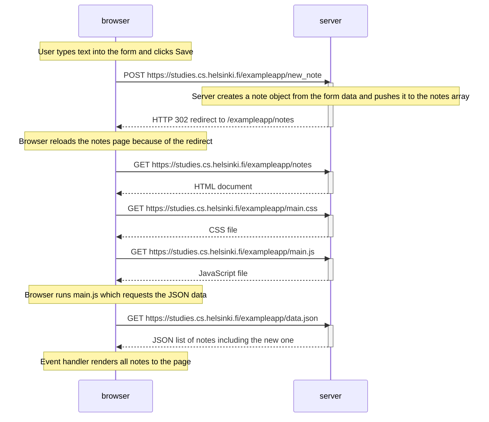
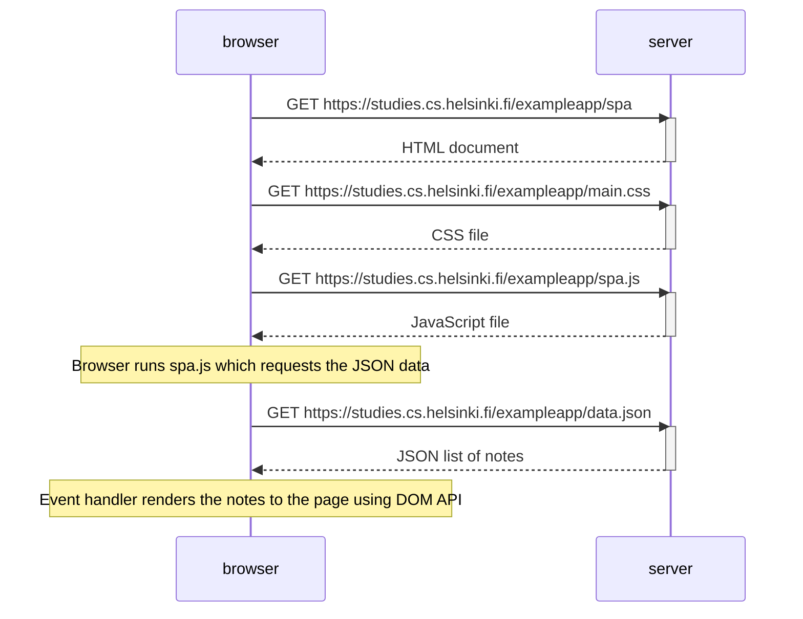
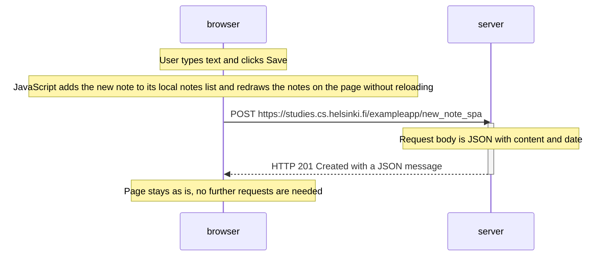

# Part 0 diagrams

Diagrams written from my reading of the Part 0 course text about the example notes app.

## 0.4: New note in traditional notes page

## 0.5: Single page app

## 0.6: New note in single page app

